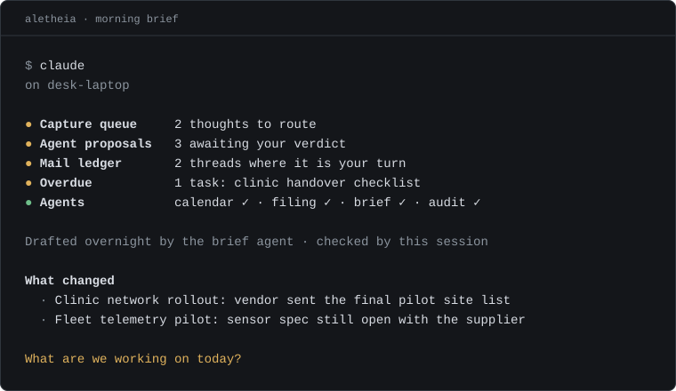
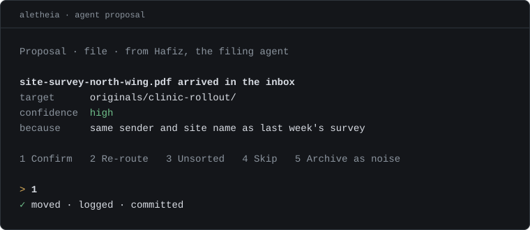

# Aletheia

Aletheia is the system I run my work through. I designed it, I use it every working day, and I keep it running. The code is private. This page shows how it is built and how it behaves.

*One brain, several ways in, and a queue between the agents and the record.*

## The rules it runs on

**Seeing and acting are kept apart.** An agent that sees widely cannot act. An agent that acts works in a narrow lane. Anything that touches the record or needs judgment becomes a proposal, and I approve or reject it. The test for acting without asking is reversibility: only work that can be undone or regenerated runs on its own.

**Machines declare what they can do.** Work that needs a capability the current machine lacks is parked with a done-check, then drained on a machine that has it.

**Decisions are written down.** Structural choices are recorded as architecture decision records. Later work cites or amends them.

**Unattended work can be stopped from anywhere.** A flag file halts it. I can commit the flag from any machine, and a flag the system cannot read halts it too.

## How it is built

**One brain.** Plain markdown files in a git repository are the record: tasks, a session log, ideas, decisions, and the status of each piece of work. A Postgres and pgvector index sits over them for search and recall. It can be rebuilt from the files at any time, so it is never the source. An MCP server exposes the brain as tools, and any AI client reads the same record.

**The Staff.** Background agents run on a home server, each with one narrow job. One syncs deadlines to my calendar. One files incoming documents. One drafts the morning brief overnight. One audits the repository on a schedule. Each reports a heartbeat, so I can see which are healthy and which have gone stale. Clerks do mechanical work on scripts or a small model. Counsel do judgment work on a frontier model: design critique, analysis, research, code review, and a check on anything I am about to send.

**Surfaces.** A terminal session on my laptop is the desk. A phone app shows digests and takes a thought on the move. A heads-up dashboard gives a third view.

## A day in use

*Screens below use demo data.*

*The morning brief: drafted overnight, checked when the session opens.*

*An agent proposes. I answer in one line.*
