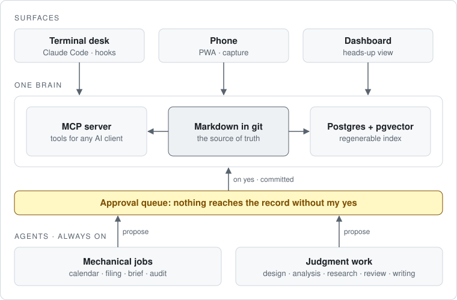
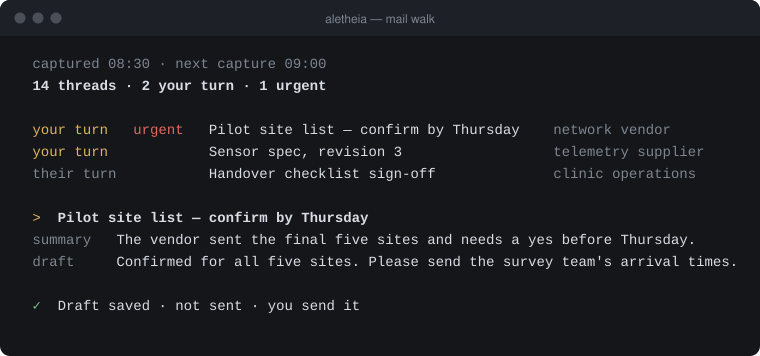

# Aletheia

Aletheia is the system I run my work through. I built it, I use it every working day, and I keep it running. This page shows how it is built and how it behaves.

<picture>
  <source media="(prefers-color-scheme: dark)" srcset="assets/architecture-dark.svg">
  
</picture>

*Every surface reads the same brain, and the agents reach it only through the approval queue.*

## The rules it runs on

**Seeing and acting are kept apart.** An agent that sees widely cannot act. An agent that acts works in a narrow lane. Anything that touches the record or needs judgment becomes a proposal, and I approve or reject it. The test for acting without asking is reversibility: only work that can be undone or regenerated runs on its own.

**Machines declare what they can do.** When a job needs a capability the current machine lacks, it is parked with a done-check and drained later on a machine that has it.

**Decisions are written down.** I record each structural choice as an architecture decision record, and later work cites or amends it.

**Unattended work can be stopped from any machine.** Committing a flag file halts it, and a flag the system cannot read halts it too.

## How it is built

The record is plain markdown in a git repository: tasks, a session log, ideas, decisions, and the status of each piece of work. A Postgres and pgvector index sits over the files for search and recall. It can be rebuilt from them at any time, so it is never the source. An MCP server exposes the record as tools, and every AI client I use reads the same brain through it.

Background agents run on a home server, each with one narrow job: syncing deadlines to my calendar, filing incoming documents, drafting the morning brief overnight, auditing the repository on a schedule. Each reports a heartbeat, so I can see which are healthy and which have gone stale. Mechanical jobs run on scripts or a small model. Judgment work runs on a frontier model: design critique, analysis, research, code review, and a check on anything I am about to send.

I work in a terminal session on my laptop. A phone app is for reading and for catching a thought on the move. A heads-up dashboard shows what is waiting for a decision.

## A day in use

*Screens below use demo data.*

*The morning brief: drafted overnight, checked when the session opens.*

*An agent's proposal waits for my answer, which takes one line.*

*Mail is captured every half hour. A reply stays a draft until I send it myself.*

The code is private. If you want to see it running, ask me for a walkthrough.
